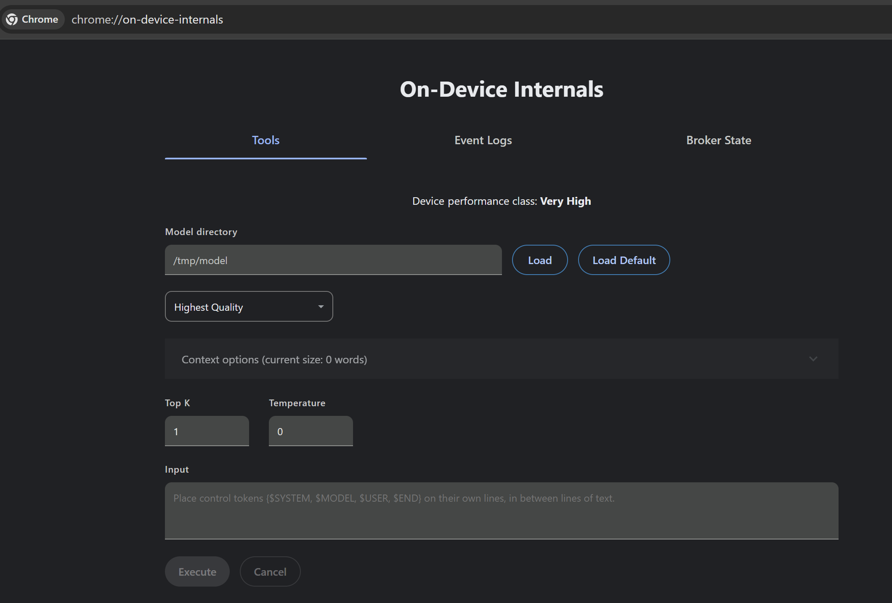
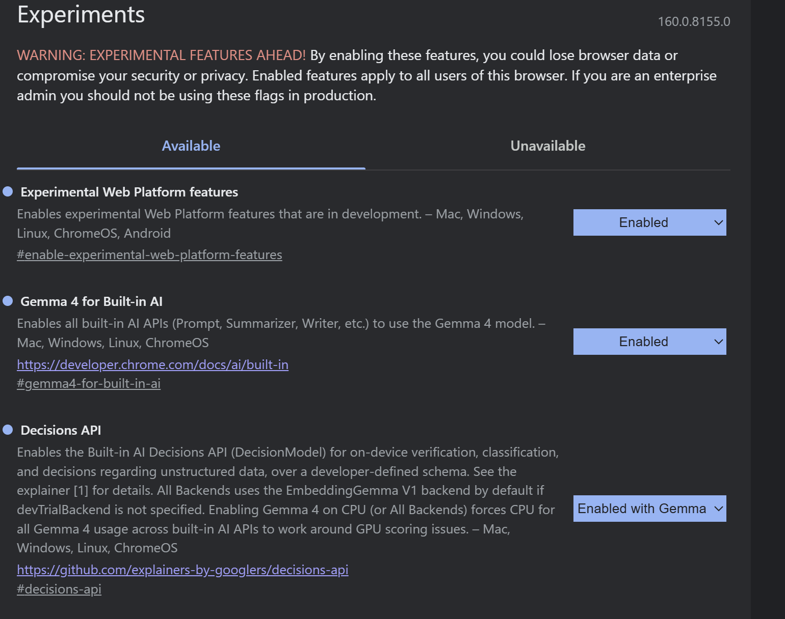
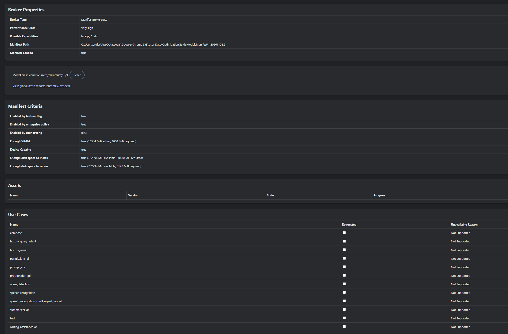
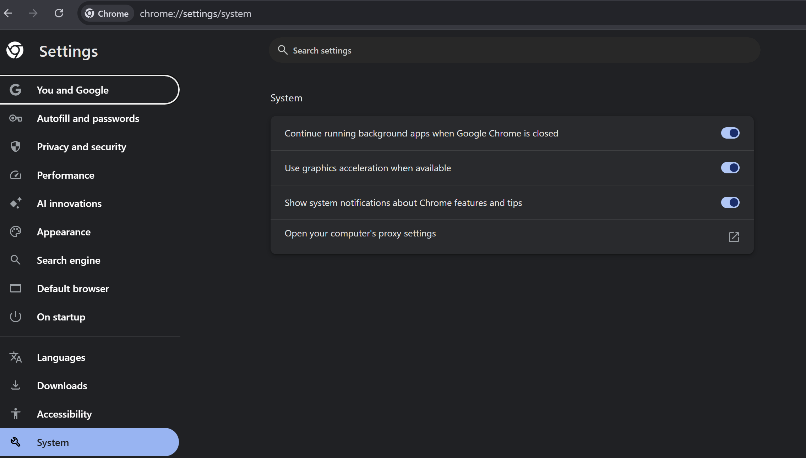
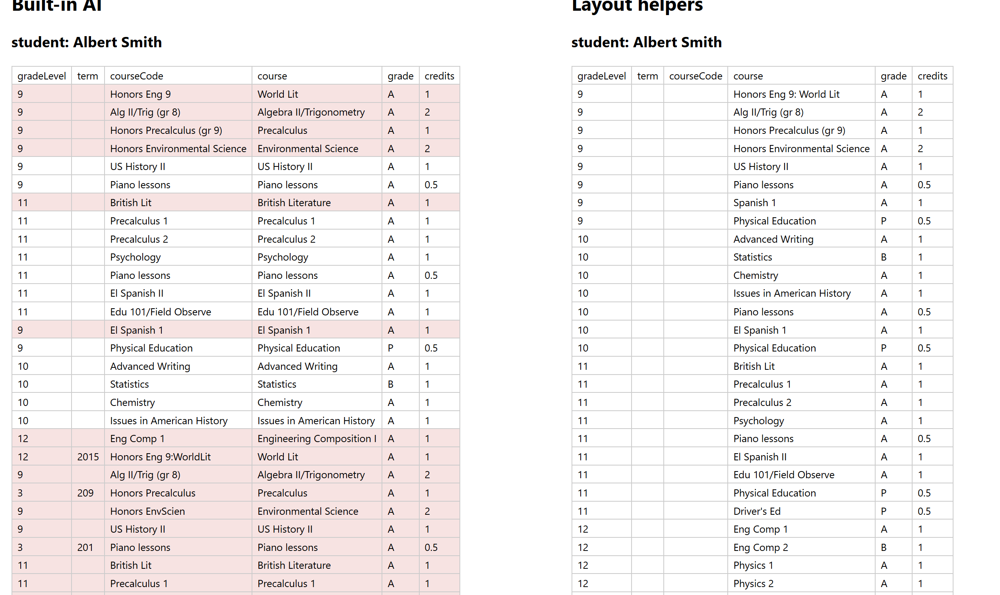

# Initialization

## Bruce's Ask

The general thing I would like to do is [create an enhancement](../types/NewEnhancementInstructions.md), similar to [be-literate](../../be-literate/), but which does much more -- it reads a PDF and pulls information out of it.

That last sentence has lots of things to decide -- which libraries, if any, are needed to help with that?  How powerful can we make that?  Is something like what is suggested in the README.md the most effort way to do it.  Is this something that could use AI capabilities, either built into the browser (I think Chromium browsers may provide something along those lines), or calling an AI service?

Typical use case -- reading transcripts from a college.

Please provide your thoughts below before implementing anything.

## Claude's Thoughts

No code yet, per your request. This is how I'd approach it, followed by questions for you.

### 1. Treat it as a pipeline, not a single regex

"Reads a PDF and pulls information out of it" is really four separate steps, and each one needs its own decision:

| Stage | What it does | Candidate tech |
|-------|--------------|----------------|
| **Read** | Get the file's bytes | `file.arrayBuffer()` (no `FileReader` needed), as in be-literate |
| **Extract** | Bytes → text *with position info* | pdf.js (`pdfjs-dist`); OCR fallback for scanned pages |
| **Structure** | Text → records (`{term, course, title, credits, grade}`) | Declarative rules (regex), or AI |
| **Store/emit** | Records → event + `writeTo` | `fifteenth`'s `set`, same as be-literate |

Read and Store/emit are basically solved by be-literate. All the real decisions are in Extract and Structure.

### 2. Libraries

- **pdf.js (`pdfjs-dist`, Mozilla)** is the clear choice for extraction. It's what Firefox uses, it ships as an ES module, and it has no build-step requirement. The key API is `page.getTextContent()`. It returns text *items*, each with an `(x, y)` transform, not lines. That position data matters a lot for transcripts (see section 3).
  - Cost: roughly 1MB+ including the worker. We should load it with a dynamic `import()` only when a PDF is actually selected. It also needs `GlobalWorkerOptions.workerSrc` set, which means an extra import-map entry in `imports.html`.
- **`unpdf`** is a thin, more modern wrapper around pdf.js. It's convenient, but it's one more dependency. I'd use pdf.js directly.
- **`pdf-lib`** is for creating and editing PDFs, not extracting text. Not relevant here, except maybe for generating test fixtures.
- **Tesseract.js (OCR)** is only needed for *scanned* transcripts, i.e. pages with no text layer. It's heavy (WASM plus language data, several MB), so it should be an opt-in tier that's lazy-loaded when a page comes back from pdf.js with no text. I'd **defer it past v1**. Many transcripts today are e-transcripts (Parchment, National Student Clearinghouse, etc.) that have a real text layer.

### 3. Is the README's regex approach the right one?

I'm reading "most effort way" as "most *effective* way". Short answer: it's a good **escape hatch**, but as written it will be fragile on real transcripts:

1. **pdf.js doesn't give you lines.** Text items come in content-stream order, and that can jump around. Many transcripts are **two-column**, with Fall on the left and Spring on the right. Naively joining items interleaves the columns, and a course regex then matches across both. The fix is to rebuild lines by clustering items on `y` (with a tolerance), sorting by `x` within each line, and detecting column gutters. Matching per *line* is then much more robust than matching over the whole document.
2. **Records need context.** A course row doesn't contain its term ("Fall 2023"). That comes from a heading line above it. So instead of one flat regex, we need a small *stateful* rule set:
   ```json
   "rules": [
       {"match": "^(?<term>(Fall|Spring|Summer|Winter)\\s+\\d{4})", "sets": ["term"]},
       {"match": "(?<course>[A-Z]{2,4}[\\s-]?\\d{3,4}[A-Z]?)\\s+(?<title>.+?)\\s+(?<credits>\\d+\\.\\d{1,2})\\s+(?<grade>[A-F][+-]?|P|NP|W|I|IP|CR|NC|AU)\\b", "emits": "courses"}
   ]
   ```
   Each emitted record inherits the most recently `sets` values. That covers terms, the "Transfer Credit" sections, and so on. (The [`nested-regex-groups`](../types/nested-regex-groups/) package already in the ecosystem may cover part of this. I'll check before writing anything new.)
3. **Grade and course-code variety.** The README regex only allows `A–F[+-]`, but real transcripts also use `P/NP/W/I/IP/CR/NC/AU`, repeat markers, and course codes like `MATH-1010` or `ENGL 1301H`. Every institution is a little different, which is the core weakness of the regex approach.
4. **There's a bug in the README example.** In JSON, `"\b"` is the *backspace* character, not a regex word boundary. It needs to be `"\\b"`. Also, `"/.../g"` as a string means we'd have to parse out the flags. Separate `"pattern"` and `"flags"` keys, or just always matching all occurrences, would be simpler.
5. **Repeated page headers and watermarks.** Student name/ID repeated on every page, and "ISSUED TO STUDENT" security backgrounds, show up as text items. Rules for ignoring them are useful, or we can drop text with unusual rotation or size.

So I'd keep regex rules in the design, but **on top of a layout-aware line extraction**, and not as the main answer for "any college's transcript".

### 4. Should it use AI?

Yes, as an **optional, pluggable** structuring step. Transcripts are exactly the messy, institution-specific layout problem where an LLM beats hand-written rules. Two options:

**a) Built-in browser AI (Chromium's Prompt API / Gemini Nano, `LanguageModel`)**
- Pros: runs **on-device**, so **no student data leaves the machine**. That's a big deal for transcripts, which are FERPA-protected PII. It's free, needs no API key, and needs no server. It supports **structured output** via `responseConstraint` (a JSON Schema), which fits "give me `courses[]`" well. You're already Chromium-only (Chrome 146+), so the browser-support limitation matters less for this ecosystem than it usually would.
- Cons: availability depends on hardware and disk (a multi-GB model download, with GPU/RAM requirements). The first use has to trigger a download. The context window is small, so we'd process **page by page**. A small model is less accurate than a frontier model, and quite capable of inventing a row. Edge has its own Prompt API implementation (Phi-4-mini), but Firefox and Safari have nothing. **I'd need to verify where the Prompt API stands for regular web pages (vs. extensions/origin trial) as of today before relying on it.**
- Related built-in APIs (Summarizer, Language Detector, Translator) aren't very useful for extraction.

**b) A cloud AI service (Claude, etc.)**
- Pros: much better accuracy. Some APIs (Claude included) accept the **PDF itself**, which handles scanned pages and complex layouts without pdf.js or OCR, and they support schema-constrained JSON output.
- Cons: **an API key can't live in client-side HTML.** It needs a backend proxy, which is outside what an HTML enhancement should own. It also sends student records to a third party, which institutional users may not be allowed to do. And it costs money per document.
- My suggestion is that be-pdfing **doesn't talk to any AI vendor directly**. It should POST the extracted text (or the PDF) plus the desired JSON Schema to a **user-supplied endpoint**, and that endpoint is where vendor choice, keys and privacy policy live.

**Guarding against hallucination:** transcripts contain their own checksums, like term and cumulative credit totals and GPA. The enhancement can recompute those from the extracted rows and flag mismatches (`validation: {creditsMatch: false}`). That's a cheap, strong check, and it works for any of the structuring strategies.

### 5. Recommended shape

Make the stages and tiers explicit and load each one only when it's used:

```html
<input type=file accept=".pdf" be-pdfing='{
    "extract": "layout",
    "structure": {
        "via": "rules",
        "rules": [ ... ]
    },
    "schema": "transcript",
    "writeTo": "indexedDB://transcripts/{file.name}"
}'>
```

- `extract`: `"text"` (raw), `"layout"` (lines/columns, the default), and later `"ocr"`.
- `structure.via`: `"none"` (just emit lines), `"rules"` (deterministic), `"builtin-ai"` (Prompt API, falling back to rules or none if unavailable), `"endpoint"` (POST to a URL).
- `schema`: a JSON Schema object, or a built-in preset name like `"transcript"`. It's used as the AI `responseConstraint` and also to validate rule output.
- Events: `load` (same as be-literate, with `enh` stamped), plus `extracted` (lines) and `structured` (records), so consumers can hook in at any stage, and `progress` per page.
- Results are also on the instance (`lines`, `records`, `validation`), and the enhancement supports programmatic attachment via `def.js` from the start, per the addendum.

**Relationship to be-literate:** I'd make be-pdfing **standalone** rather than stacking it on be-literate. be-literate's `FileManager` is coupled to its own props, and PDFs always want `ArrayBuffer`, so `readVerb` is pointless here. We'd copy over be-literate's conventions (`writeTo` via fifteenth, `{file.*}` substitution, the `enh` stamp, `initialized` gating) rather than its code.

### 6. Suggested phasing

1. **v1:** scaffold per `NewEnhancementInstructions.md`, then pdf.js layout extraction producing `lines`, then `rules` structuring, then `writeTo`. Playwright tests against fixture PDFs.
2. **v2:** `builtin-ai` with schema plus totals validation, with feature detection and a graceful fallback.
3. **v3:** `endpoint` strategy and the OCR tier.

### Questions for you

1. **Sample transcripts:** do you have a few real (redacted) or realistic transcript PDFs, ideally from different institutions and including a two-column one? They'd drive both the line-reconstruction logic and the test fixtures. If not, I can generate synthetic ones with pdf-lib for tests.
2. **v1 scope:** are you OK with v1 being deterministic only (layout plus rules), with built-in AI as v2? Or do you want the Prompt API in from the start, since it's the more interesting part?
3. **Output granularity:** one record per *file* (`{student, terms: [{term, courses: []}], totals}`), or one store entry per *course row*? This affects the `writeTo` design.
4. **Generic vs. transcript-specific:** should `"transcript"` be a built-in preset in be-pdfing, or should be-pdfing stay generic and keep transcript knowledge in demos/docs?

## Bruce's Follow up question

Would Chrome's built in AI Gemini model be able to parse the file bytes, obviating the need for the firefox library?

## Claude's Response to Follow up

**Short answer: no. pdf.js (or something like it) is still needed, even with the built-in model.**

### What the Prompt API accepts

According to Chrome's current Prompt API docs, a `LanguageModel` session accepts three input types, declared up front in `expectedInputs`:

- **text**
- **image** (`Blob`, ``, `<canvas>`, `ImageBitmap`, video frame, etc.)
- **audio**

There's no PDF or "document" input type. Output is text only, optionally constrained by a JSON Schema. Multimodal (image/audio) input is also newer and less settled than text input. MDN dates it to Chrome 148, and there's a `prompt-api-for-gemini-nano-multimodal-input` flag for development, so I'd re-check its status before depending on it.

### Why you can't just hand it the bytes

1. **There's no slot for them.** A PDF `Blob` passed as an "image" isn't a format the browser can decode as an image. I'd expect a `NotSupportedError` or a decode failure.
2. **Even as text, raw PDF bytes are close to useless.** The page content in a PDF is usually *compressed* (FlateDecode streams), and the text often uses font-specific glyph encodings, so the actual characters aren't present in readable form. Decoding all that is exactly what pdf.js does. Asking a small on-device model to do it from raw bytes would fail, and the bytes would blow through its context window anyway.
3. **Chrome's own PDF engine (PDFium) isn't available to page JavaScript.** The browser can *display* PDFs, but it doesn't expose text extraction or rendering to scripts.

### Where AI can still replace part of the pipeline

The model can replace the **Structure** step (and, with images, some of the layout heuristics), but not the **Extract** step. There are two routes:

- **Text route (what I recommended before):** pdf.js extracts the text and lines, then Gemini Nano turns the lines into JSON records using `responseConstraint`. This is the most reliable on-device option.
- **Image route:** pdf.js renders each page to a `<canvas>`, then the canvas is passed to Gemini Nano as an image with a prompt like "extract the courses as JSON." That sidesteps the two-column and reading-order problems, and it would also handle **scanned** transcripts without Tesseract. But it **still uses pdf.js**, just for rendering instead of text extraction. A small model also reading dense, small-font tables from an image is likely to be *less* accurate than the text route. It would be a good option to try, maybe as a fallback when a page has no text layer.

### The one way to skip pdf.js entirely

Cloud models such as Claude accept the PDF file directly and do the decoding and rendering on the server side. That would remove pdf.js, but it brings back the trade-offs from section 4b: the transcript leaves the device, and you need a server-side proxy to hold the API key. That fits the `"endpoint"` strategy, not the built-in one.

### Effect on the plan

There's no change to v1: pdf.js remains the foundation. For v2 I'd add `"structure": {"via": "builtin-ai", "input": "text" | "image"}`, so we can compare the two routes on real transcripts. `"image"` would also be the natural way to handle scanned pages.

Sources: [Chrome: The Prompt API](https://developer.chrome.com/docs/ai/prompt-api?hl=en), [MDN: Multimodal prompts](https://developer.mozilla.org/en-US/docs/Web/API/Prompt_API/Multimodal), [MDN (de): Multimodal prompts](https://developer.mozilla.org/de/docs/Web/API/Prompt_API/Multimodal)

## Bruce's Response II

Let's go in baby steps as you recommend.  I added two [sample](../demo/home-school-transcript-example.pdf) [transcripts](../demo/sample-transcript.pdf) but really I don't want things too tied to transcripts.  I think maybe "tables of information" is the focus.

Let's please start with 

> 1. **v1:** scaffold per `NewEnhancementInstructions.md`, then pdf.js layout extraction producing `lines`, then `rules` structuring, then `writeTo`. Playwright tests against fixture PDFs.

## Claude's v1 Implementation Notes

v1 is done. All 6 Playwright tests pass on Chromium, using your two sample PDFs as fixtures. I kept everything generic ("tables of information"). The transcript-specific knowledge lives only in the rules in the tests, the demo, and the README examples, and there's no transcript preset.

### What your samples showed

Both samples are **two-column** layouts, the hard case from my earlier notes:

- In `home-school-transcript-example.pdf`, two tables sit side by side (Grade 9 | Grade 10, Grade 11 | Grade 12).
- In `sample-transcript.pdf`, the left column runs five terms of courses, while the right column holds one term of courses and then a summary table.

In both, pdf.js reports a left row and a right row with the same `y`, so each visual line holds one row from *each* column. `sample-transcript.pdf` also draws its footer first, so the items have to be sorted.

### Design

**1. Lines and cells ([extractLines.js](../extractLines.js)).** Text items are grouped into lines by baseline, top to bottom. Within a line, they're split into **cells** wherever the horizontal gap is wider than about one font height. `line.text` joins the cells with `\t`. For example:

```
00001	ENGL1	English 9	A	0.50	0.50	B	00011	ENGL3	English 11	A	0.50	0.50	B
```

So rule authors can use `\t` and `[^\t]+` ("one cell") instead of guessing at spaces. That one decision makes the regexes far more robust. Each cell also keeps its `x` and `width`. Rotated text is skipped, and so is "fake bold" (the same text drawn twice).

**2. Rules ([applyRules.js](../applyRules.js)).** Rather than one regex, rules are an ordered list of `{pattern, flags?, emits?, sets?}`:

- `emits: "courses"` adds a record per match, built from the named groups.
- `sets: true` makes the named groups **context** for the records below it. The key decision is that context is **inherited only by records that overlap the heading horizontally**. That's what solves the two-column problem *without* detecting columns at all: "Grade 10" sits above the right half, so only right-half rows inherit it, even though they share lines with Grade 9 rows. I first considered splitting each page into columns by finding gutters, but tables have internal gutters too, so the overlap approach was both simpler and more reliable on your samples.
- `sets: "document"` is for page-wide facts such as `Student: Albert Smith`. It applies to every later record.
- Rules **claim** the text they match, in the order they're listed, so earlier rules take priority. A rule with neither `emits` nor `sets` just hides text, such as headers and footers.

Results: `home-school` → 31 courses, each with the right `gradeLevel`. `sample-transcript` → 30 courses, each with the right `moYr`/`gradeLevel`, including the right column's 06/2020 term. The `Cumulative` totals row comes out as a separate collection.

**3. The enhancement ([be-pdfing.js](../be-pdfing.js), [emc.mjs](../emc.mjs)).** It follows `NewEnhancementInstructions.md` and the addendum: plain class, roundabout, `initialized` gating, `def.js`, and all three attachment patterns tested. It has three actions:

- `hydrate`: listens for `change`.
- `structure`: runs when `extracted` **or `rules`** change. So reassigning `rules` re-applies them without re-reading the PDF, which the demo uses for live rule editing.
- `storeResults`: `writeTo` through fifteenth. It writes `records` when there are rules, `lines` otherwise, with `{file.name}` and other placeholders substituted.

Events are `load` (`event.results`, `event.enh`), `progress` (one per page), and `error` (a file that isn't a valid PDF). pdf.js is loaded by dynamic `import()` only once a file is selected.

**4. Demo ([demo/index.html](../demo/index.html)).** Pick a PDF and you see the extracted lines on the right and the records as tables on the left, with a rules textarea and presets for both samples.

### Things to know

1. **spa-ssi serves `.mjs` as `text/html`**, because it treats `.mjs` requests as server-side includes. So Chrome refused to load pdf.js, which ships only `.mjs`. To work around it, `npm run serve` (via a `preserve` hook) copies pdf.js's two modules into a gitignored `vendor/` folder as `.js` files, and `imports.html` maps the `pdfjs-dist/build/...` specifiers there. The source code keeps the real specifiers, so consumers aren't affected. **A cleaner fix would be in spa-ssi itself:** serve an `.mjs` that has no `render` export as `text/javascript`. Want me to look at that?
2. **The `types` submodule has a new `be-pdfing/types.d.ts`.** It needs committing there, as with be-literate.
3. **The README's `"\b"` bug is fixed**, and the README now documents all of the above, including the programmatic-attachment section the addendum asks for.
4. **No emoji shorthand yet.** Let me know if you'd like one (📑?).
5. **Nothing is committed.**

### Known limitations (candidates for later steps)

- **Records come out in line order**, so side-by-side tables interleave: G9 row, G10 row, G9 row, and so on. Each record has the correct context, but you may want them grouped by column.
- **Context never "ends."** A record inherits any earlier heading above it in its column, even one that belongs to a previous table. In `sample-transcript.pdf`, the `Cumulative` totals row inherits `moYr: 06/2020` from the course table above it. A possible fix would be a way for a rule to *clear* context, e.g. `"clears": true` on a heading such as `Report Period and Cumulative Summary`.
- **Values are strings.** Number conversion (`"0.50"` → `0.5`) would be easy to add, e.g. `"types": {"credits": "number"}`.
- **Multi-line cells** aren't joined. `sample-transcript.pdf`'s stacked column headers ("State / CRS / Code") come out as three lines. That doesn't matter for data rows.
- **Scanned PDFs** produce no lines. That's the later OCR or AI-image tier.

## Bruce's Response - event handler?

Thanks for doing step 1.  Honestly, it went a little further than I was expecting, probably due to me not picking up on some subtleties of the summary.  In particular, I'm still thinking about the regex usefulness and wasn't expecting that to already be (partially) baked in.  Let's keep it for now.

I'm thinking that the first integration we should support is an event handler that can have custom logic, and maybe provide help utilities that the handler could use to make it easier?  What do you think?  If this seems like a reasonable approach, please sketch what that would look like below.

## Claude's Sketch: Event Handler + Helpers

Yes, I think this is the right primary integration, and it fits your hesitation about regex. **A handler with plain JavaScript and good helpers covers everything rules can do, and much more.** Real tables need logic that patterns express badly: "stop at the GPA row", "skip repeated headers", "convert the numbers". So I'd make the handler the main path, and treat rules as just *one* helper (plus a no-JS shortcut in the attribute). No code yet; this is the sketch.

### 1. The contract: the handler receives lines and produces records

Very little changes in the pipeline. Today `load` is already dispatched *before* `writeTo` runs, so the handler only needs a way to hand records back:

```
file selected → extract lines → [rules, if any] → load event / handler → writeTo
                                                        ↑
                               reads event.lines, sets event.records
```

What the handler receives (one call per file):

| Member | Meaning |
|--------|---------|
| `event.file` | The `File` |
| `event.lines` | The extracted lines (as today) |
| `event.records` | Pre-filled with the rules' output if there are rules; otherwise `undefined`. **The handler sets or modifies it.** |
| `event.helpers` | The helper functions (section 3). They're on the event so that inline handlers, which can't `import`, can use them. |
| `event.waitUntil(promise)` | For async logic (e.g. a lookup). `writeTo` waits for it. |
| `event.enh` | `'bePdfing'` (as today) |

Whatever ends up in `event.records` is what's written to `writeTo` and set on `results`.

### 2. Two ways to attach it

**a) Inline attribute (server-rendered / no build).** For an inline `on*` attribute to work, the event has to have a standard name. `load` is one, and it's what be-literate already uses:

```html
<input type=file accept=".pdf" be-pdfing='{"writeTo": "indexedDB://pdfs/records/{file.name}"}' onload="
    if(event.enh !== 'bePdfing') return;
    const {lines, helpers: {tables, num}} = event;
    event.records = tables(lines, {header: /Grade (?<gradeLevel>\d+)\tGr\tCr/, until: /^GPA/})
        .flatMap(t => t.rows.map(r => ({gradeLevel: t.header.gradeLevel, course: r[0], grade: r.Gr, credits: num(r.Cr)})));
">
```

The CSP caveat from be-literate's README applies to inline handlers. The alternative is `addEventListener('load', ...)` from a script, with the same contract.

**b) Programmatic: a `handler` property** (following be-calculating's lead, as the addendum notes). This is the more ergonomic route for frameworks:

```JS
myInput.enh.set.bePdfing.handler = ({file, lines, records, helpers}) => {
    // return the records (or a Promise of them)
    return {courses: [...]};
};
```

A return value is cleaner than mutating the event. The handler is called before the `load` event is dispatched, so `load` listeners see the final records.

### 3. The helpers (`be-pdfing/helpers.js`)

These are pure functions over `lines`, also importable on their own. Here's a first cut, ordered by how much I think each one earns its place:

| Helper | What it does | Why |
|--------|--------------|-----|
| `tables(lines, {header, until?, columns?})` | Finds every line matching `header` (a regex or an array of header texts), then collects the lines below it. **Each cell is assigned to a column by its x-position under the header cells.** Collection stops at `until` or when a line has no cells under the header. Returns `[{header: {...named groups}, columns: [...], rows: [{0: 'Honors Eng 9…', Gr: 'A', Cr: '1'}, ...]}]`. | This is the core of "tables of information". It uses x-alignment rather than cell order, so it isn't thrown off by **empty cells** (like PE's missing DSG), and it handles **side-by-side tables** because each header only claims rows under its own x-range. |
| `columnsOf(lines, {gutter?})` | Splits lines into column streams, i.e. left-column lines, then right-column lines. It detects a gutter or takes an explicit x. | Fixes the interleaving limitation. You can process each column top to bottom with ordinary loops. |
| `valueAfter(lines, label)` | The text of the cell right after a label cell: `valueAfter(lines, 'Student:')` → `'Albert Smith'`. It can also look *below* the label (`{below: true}`), for forms laid out as label over value. | Form-like header blocks (name, dates, IDs) appear on almost every document. |
| `between(lines, start, end?)` / `after(...)` | Slices lines between two patterns. | Narrows the search ("only the ACADEMIC RECORD section"). |
| `matches(lines, pattern)` | Yields `{line, match, x0, x1}` for every match. This is the internal engine of `applyRules`, exposed. | A building block when you need regex but your own control flow. |
| `applyRules(lines, rules)` | Exactly today's rules engine. | The regex approach becomes optional, one helper among several. |
| `num(s)`, `date(s)` | Lenient conversions (`'0.50'` → `0.5`, `'01/2018'` → ISO, `''` → `undefined`). | Values are strings today. |

### 4. The two samples, written as handlers

**Home-school**, where the side-by-side tables are handled by `tables`:

```JS
handler: ({lines, helpers: {tables, valueAfter, num}}) => ({
    student: valueAfter(lines, 'Student:'),
    courses: tables(lines, {header: /Grade (?<gradeLevel>\d+)\tGr\tCr/, until: /^GPA/})
        .flatMap(({header, rows}) => rows.map(r => ({
            gradeLevel: num(header.gradeLevel), course: r[0], grade: r.Gr, credits: num(r.Cr),
        }))),
})
```

**Sample transcript**, where the column stream plus a plain loop handles stateful logic:

```JS
handler: ({lines, helpers: {columnsOf, between, num}}) => {
    const courses = [];
    for(const column of columnsOf(between(lines, /ACADEMIC RECORD/, /SAMPLE TRANSCRIPT/))){
        let term;
        for(const {text, cells} of column){
            const heading = /MO\/YR: (\S+)\t(?:GRD )?LEV: (\d+)/.exec(text);
            if(heading){ term = {moYr: heading[1], gradeLevel: heading[2]}; continue; }
            if(/Report Period/.test(text)){ term = undefined; continue; }   // context *can* end here
            const [stateCode, courseCode, description, grade, earn, attp, dsg] = cells.map(c => c.text);
            if(term && /^\d{5}$/.test(stateCode)){
                courses.push({...term, stateCode, courseCode, description, grade,
                    credEarn: num(earn), credAttp: num(attp), dsg});
            }
        }
    }
    return {courses};
}
```

Both of the "known limitations" from v1 go away here without any new rule features. Interleaving is fixed by `columnsOf`. Context that "never ends" is fixed by `term = undefined`, because it's just code.

### 5. What I'd change from v1

- Keep `rules` as an attribute-level, no-JS shortcut, and *also* export it as a helper. If you'd rather de-emphasize it, I'd move it lower in the README, after the handler section.
- Add the `handler` property, plus `event.records`, `event.helpers` and `event.waitUntil` on the `load` event.
- Add `helpers.js`. I'd build `tables`, `columnsOf` and `valueAfter` first, since they carry the most weight, test them against both samples, and leave `date` until there's a need.
- Should `load` be dispatched once per file instead of once with `results[]`? With per-file handler semantics, one event per file is simpler (`event.file`, `event.lines`, `event.records`). The cost is a breaking change to v1's `event.results`, but v1 has no users yet.

### Questions

1. Is `load`, with a settable `event.records`, OK as the event name? It's needed for inline `onload` handlers. Or would you rather have a custom name like `pdfing`, and only support `addEventListener` and the `handler` property?
2. Should I switch to **one event per file**, as described above?
3. Should `rules` stay as a top-level property, or become a helper only?
4. Does this helper list match what you had in mind, or were you picturing something different, e.g. helpers aimed at a particular output shape?

## Bruce's Response 

I like to follow the same 'load' as the event name.

As far as one event per file, that's a tough one.  What does be-literate do?  I think they should probably be consistent (even if it breaks backwards compatibility, which shouldn't block us at all), but it's possible that be-literate made the wrong decision.  What do you think the typical developer / ai agent would expect / want?

Let's hold on to rules for now as a top level property.

The helper functions you propose sound reasonable to me.


## Claude's Response: one event per file?

**What be-literate does:** it fires **one** `load` event after *all* the selected files have been read, carrying an array (`event.fileContents`, one entry per file). It also sets that array on the instance (`fileContents`) and writes to `writeTo` once per file. be-pdfing v1 already mirrors this with `event.results`.

**My recommendation: keep one `load` event per selection, consistent with be-literate.** I think be-literate made the right call, for these reasons:

1. **It mirrors the platform.** The native `change` event fires once per selection, and `input.files` is a list. A developer (or an agent) who knows `<input type=file>` already thinks in terms of "the selection", so "`load` fires when the selection has been processed" is the least surprising rule.
2. **"Everything is done" is what listeners usually want.** Rendering a summary, enabling a submit button, or comparing two transcripts all need every file. With per-file events, each listener would have to count files itself.
3. **The single-file case stays a one-liner.** Most file inputs don't have `multiple`, and `const [result] = event.results` (or `event.results[0]`) is a familiar pattern.
4. **Consistency across the family is worth more than a marginal ergonomic win.** An agent that has seen one be-* file enhancement should be able to guess how the next one behaves.

**The handler, though, is naturally per file.** Custom logic is about *one document's* lines, so I'd split the two cleanly:

- **`handler` property:** called **once per file**, as `({file, lines, records, helpers}) => records`, before `load` fires. Its return value becomes that file's `records`.
- **`load` event:** fires **once**, after all handlers have run. Each entry of `event.results` is `{file, numPages, lines, records}`, and **`records` on each entry is settable**, which gives inline `onload` handlers the same power:

```html
<input type=file accept=".pdf" be-pdfing onload="
    if(event.enh !== 'bePdfing') return;
    const {tables, num} = event.helpers;
    for(const result of event.results){
        result.records = tables(result.lines, {header: /Grade (?<gradeLevel>\d+)\tGr\tCr/, until: /^GPA/});
    }
">
```

- `event.helpers` and `event.waitUntil(promise)` are on the event once (not per entry), and `writeTo` waits for any `waitUntil` promises before writing each file's records.

The only change for v1 is additive: `results[i].records` becomes writable from a listener, plus the new `handler`, `helpers` and `waitUntil`. Nothing breaks.

If that works for you, the next step would be: add `helpers.js` (`tables`, `columnsOf`, `valueAfter`, then `between`, `matches`, `num`), the `handler` property, the event members, and Playwright tests that use handlers against both sample PDFs.

## Bruce's Response II

Sounds good, please proceed and add implementation notes below.

## Claude's Implementation Notes: handler + helpers

Done, with all 16 Playwright tests passing (6 from v1 + 10 new). Nothing is committed. **The types submodule now has further changes** in `be-pdfing/types.d.ts` that need committing there.

### What changed

| File | Change |
|------|--------|
| `helpers.js` (new) | `tables`, `valueAfter`, `columnsOf`, `between`, `after`, `matches`, `num`, plus `applyRules` re-exported. Pure functions over `lines`; also exported as `be-pdfing/helpers.js`. |
| `be-pdfing.js` | `structure` now runs rules → `handler` (once per file) → one `load` event. `LoadEvent` gains `helpers` and `waitUntil()`, and listeners may set `results[i].records`. `storeResults` writes `records` whenever any exist (no longer only when there are rules), otherwise `lines`. |
| `emc.mjs` / `emc.json` | `structure` also re-runs when `handler` changes. |
| `applyRules.js` | Only exports two internal utilities (`cellStarts`, `xAt`) for `helpers.js` to reuse. Behavior is unchanged. |
| `types/be-pdfing/types.d.ts` | `Handler`, `HandlerArgs`, `Helpers`, `Table`, `TableOptions`, `Match`, etc. `PdfResult.records` is now `any`, since a handler can return any shape. |
| `README.md` | New "Example 2: custom logic" (inline `onload`, `handler` property, the helpers, and both samples' handlers). Rules become Example 3 ("without JavaScript") and writeTo Example 4. The property table gains `handler`. |
| `demo/index.html` | Presets for a handler (live-editable JS body) as well as rules, for both samples. |
| `tests/` | `Helpers.spec.mjs` (8 unit tests that run in Node with pdf.js's legacy build), `ProgrammaticHandler` and `AttributeOnload` (multiple files, `event.helpers`, `waitUntil`, writeTo). |

### Bug found along the way

In pdf.js 6, `destroy()` exists on the *loading task* only, not on the document proxy. v1's `await pdf.destroy()` in a `finally` block was therefore throwing on every read. The lines had already been pushed, so the tests passed, but every successful read **also dispatched a spurious `error` event**, and the worker was never released. It's fixed (`loadingTask.destroy()`), and `ProgrammaticHandler` now asserts that no error events fire.

### How `tables` works (the decisions worth reviewing)

- **Which table a cell belongs to:** when the header matches several times on one line, the page is split halfway across the gap between neighboring headers, and a cell belongs to the table containing its *center*. A single table claims the whole width.
- **Which column a cell belongs to:** the header cell it overlaps most or, if it overlaps none, the nearest one. That's what makes the sample's DSG values (which sit just *left* of the "DSG" header text) and its empty cells come out right.
- **Where a table ends:** at the first line (within its range) matching `until`, the next header overlapping it, a page break, or a vertical gap larger than 1.75× the median line spacing so far. The gap is measured between consecutive lines *of the page*, not just the table's rows. Otherwise a line with text only in the neighboring table looks like a gap; that cut the sample's left table off after its first term until I fixed it.
- **Without `until`, a table usually runs on** into whatever is below it (GPA rows, summaries), because transcripts keep their line spacing. So the README recommends `until`. A smarter default (e.g. ending when the cells stop lining up with the header) is possible, but I'd wait for a real document that needs it.
- **Rows that aren't data rows** (the sample's `MO/YR` sub-headings) come through as rows too. `table.lines[i]` gives the line behind `rows[i]` (restricted to the table), so the handler can recognize them with a regex. That's how the sample-transcript handler tracks the term, and ends it, with a plain variable.

### Other notes

- **`columnsOf`'s automatic gutter detection is a heuristic.** It looks for the x crossed by the fewest cells in the middle 40% of the page, ignoring single-cell lines, preferring the middle. It works on both samples, but centered titles land in whichever column holds their center. `{gutter: x}` overrides it. In practice, `tables` with a repeated header turned out to be the better tool for side-by-side tables, so neither sample handler ended up needing `columnsOf`.
- **`valueAfter`** returns the rest of the label's own cell when there is one (`'Entrance Date:'` → `'Sept. 1, 2014'`). So for a label-over-value layout, pass the label cell's full text (`'LEGAL NAME (Last, First, Middle)'`, `{below: true}`).
- **A handler that throws** produces an `error` event for that file, and the file's records are left as the rules produced them. Assigning a new `handler` (or `rules`) re-structures the already-extracted lines, as before. If a newer run starts while an older one is still awaiting an async handler or `waitUntil`, the older one's results are dropped.
- I left out `date()` as planned, until there's a document that needs it.

### Possible next steps

1. An emoji shorthand (📑?), like be-literate's 📖.
2. Fix spa-ssi's `.mjs` handling, so the `vendor/` copy step can go.
3. Try `tables` on a non-transcript document (an invoice or a bank statement), to check that the "tables of information" focus generalizes.

## Bruce's Response - Gemini within event handler

Can you provide alternative demos / tests with the same transcript files, but which use the AI built into the browser?  The intention is to also provide declarative support, but let's start with programmatic in the event handler.


## Claude's Implementation Notes: built-in AI in the handler

Done. 20 tests pass, and 2 real-model tests are skipped by default (see below). Nothing is committed. The types submodule's `be-pdfing/types.d.ts` has more changes to commit.

### What's there

| File | What |
|------|------|
| `ai.js` (new, also exported as `be-pdfing/ai.js` and re-exported on `helpers`) | `promptForRecords(input, {schema, instructions, signal, allowDownload})`, `linesToText`, `aiAvailability`, `createSession`, `AIUnavailableError`. A thin layer over `LanguageModel`: availability → `create({initialPrompts: [system]})` → `prompt(text, {responseConstraint: schema})` → `JSON.parse` → `destroy()`. |
| `demo/transcriptHandlers.js` (new) | Shared by the demo and the tests. One **generic** `transcriptSchema` and `transcriptInstructions` for both sample PDFs, so there's no per-document code on the AI side. Also `aiHandler`, a `deterministicHandler` (the layout-helper handlers from before, normalized to the same shape) and `compareCourses` (matches by course name + grade level, then checks grade/credits). |
| `demo/ai.html` (new, linked from the main demo) | Shows availability, an "Enable built-in AI" button with download progress, and editable instructions. Its handler runs both handlers and shows the model's records next to the layout helpers', with mismatches highlighted and a score ("N of 31 exact, ..."). |
| `tests/AIHandler.*` + `tests/fakeLanguageModel.js` | 4 tests against a **fake** `LanguageModel`, injected with `addInitScript`. They check exactly what the model is asked (system prompt, column-by-column text, the schema as `responseConstraint`), that its JSON becomes the records and is written by `writeTo`, that the session is destroyed, and the error paths (unavailable, not JSON, not downloaded). |
| `tests/AIHandlerReal.spec.mjs` | The real model, run with `BE_PDFING_REAL_AI=1`. It scores the model against the deterministic handler with loose thresholds (≥ 80% of courses found, ≤ 20% extra) and logs the scores and timing. |

### Design choices worth a look

- **The text the model gets** is `columnsOf(lines)` run through `linesToText`: each column under a `=== Column N of M ===` heading, cells separated by `" | "`. Interleaved side-by-side rows seem like exactly the thing a small model would get wrong, and splitting by column costs nothing.
- **Downloads are opt-in.** Playwright's bundled Chromium (v158) *does* have `LanguageModel`, and on this machine reports `'downloadable'`. I first gated the download on `navigator.userActivation`, but picking a file leaves an activation in effect (in Playwright, and in real use too, because extraction is fast). So **selecting a PDF could silently start a multi-GB download**. Instead, `promptForRecords` throws `AIUnavailableError` unless the model is already `'available'` or you pass `allowDownload: true`. `createSession()`, meant for a button, does download.
- Errors (unavailable, not ready, invalid JSON) come out of the handler, so they surface as the existing `error` event. With no records, `writeTo` falls back to the lines, as before.

### What I could *not* verify

**I haven't run the real model.** Doing so means a several-GB download, which seemed like your call, not mine. Edge 156 is installed but doesn't expose the Prompt API without a flag. Chrome isn't installed. Playwright's Chromium reports `'downloadable'`. To try it:

- **Demo:** `npm run serve`, open `http://localhost:8000/demo/ai.html`, click "Enable built-in AI" (once), then pick a transcript.
- **Test:** `BE_PDFING_REAL_AI=1 npx playwright test tests/AIHandlerReal.spec.mjs`. It uses Playwright's Chromium by default (`BE_PDFING_AI_CHANNEL=chrome` or `msedge` to switch), with a persistent profile under `.ai-profile/` (gitignored), so the download happens once. The 80% / 20% thresholds are guesses until we see real numbers.

How well Gemini Nano does on 30+ rows is the open question. The output is ~2k tokens of JSON, and small models tend to drop or merge rows in long lists. If it struggles, a **hybrid** is the obvious next step: let `tables` find the rows deterministically, and use the model only for the parts that are hard to express in code (which heading a row belongs to, normalizing names, odd layouts), one table at a time.

### Toward declarative support

What this suggests for the attribute: `{"ai": {"instructions": "...", "schema": {...}}}`. The enhancement would call `promptForRecords(columnsOf(lines), ...)` itself, plus a declarative way to offer the download button. That's a sketch for whenever you want to go there.

Sources consulted for the current API shape: [Chrome Prompt API docs](https://developer.chrome.com/docs/ai/prompt-api), [MDN LanguageModel.prompt()](https://developer.mozilla.org/en-US/docs/Web/API/LanguageModel/prompt), [Structured output for the Prompt API](https://developer.chrome.com/docs/ai/structured-output-for-prompt-api).

## Bruce's Response

Wow, I didn't realize that using the browsers AI capabilities still means a several GB download.  That seemingly makes it a totally unacceptable solution (especially as I want this to be useful for cheap smart phones).  Is that a permanent limitation?  Is the expectation that most people will download the GB from one site or another, so that other sites don't have to download the model?  What were the browser vendors thinking when they implemented this?

## Claude's Response: the download, phones, and what the vendors were thinking

Short version: **for cheap smartphones, the built-in AI isn't an option today, and won't be for some years.** So I'd keep it as an optional extra on top of the layout helpers, which are the part that works everywhere.

### Is the download per site?

The model is **managed by the browser, not by sites**. Chrome stores one copy (~4 GB, `weights.bin` in an `OptGuideOnDeviceModel` folder) in the browser's data, outside any site's storage. The Chrome docs describe the download as happening "the first time" a site uses one of these APIs. I couldn't find an official statement that the copy is shared across all sites. But it is stored per browser rather than per site, so a second site shouldn't trigger a second download. That was my understanding, but it isn't confirmed.

More to the point, **Chrome now downloads it by itself** on eligible desktops, for its own features. It's been widely reported (and criticized) that Chrome installs the 4 GB model without asking, and puts it back if the user deletes it. Google's answer is that it can be turned off with an "On-device AI" setting, and that the model is deleted automatically when free disk space runs low. So your guess is roughly right, though it isn't "some site" doing the download: on a capable desktop, Chrome itself has often already fetched the model, and then the cost to your site is zero. That's why the demo can show `'available'` straight away on many desktops, and why on Playwright's fresh profile it shows `'downloadable'`.

### Phones

- **The Prompt API isn't available on Android or iOS at all.** Chrome's docs say the Gemini Nano-based APIs (Prompt, Summarizer, Writer, Rewriter) are designed for desktops and laptops and don't work on mobile. The documented requirements are Windows / macOS / Linux / Chromebook Plus, 22 GB free disk, and a GPU with more than 4 GB of VRAM (or 16 GB of RAM with 4 or more cores).
- The lighter APIs, **Translator and Language Detector, do work on Android**. Chrome has said availability will be decided API by API, and the Prompt API is the most demanding.
- **Is it permanent?** Probably not forever, but cheap phones will be last. Android does have Gemini Nano (through the OS, for apps), but only on flagship-class phones. Even if Chrome for Android exposes it one day, a budget phone with 3–4 GB of RAM in total can't hold a model of this size alongside everything else. Models are getting smaller and phones better, but I'd plan on "years", and on low-end devices staying excluded longest.

### What were the browser vendors thinking?

The reasoning is coherent, even if the tradeoffs land badly for your use case:

1. **One model per device instead of one per site.** The alternative is each site shipping its own model (WebLLM, transformers.js). Because browsers partition storage by site for privacy, every site would download and cache its own copy, of hundreds of MB to several GB. A browser-managed model is the only way to pay that cost once.
2. **Privacy and cost.** The data never leaves the device (a real plus for transcripts), there's no per-request server bill, and it works offline.
3. **A bet on hardware trends.** Ship on the devices that can run it today (desktops), and widen the reach as hardware catches up.

Here's the criticism, which I think is fair:

- **It creates a two-tier web.** Features that depend on the API work on expensive hardware only.
- **It's hard to make interoperable.** Chrome uses Gemini Nano and Edge uses Phi-4-mini, so the same prompt gives different answers in each browser. That's very unlike most web APIs. As far as I know, Mozilla and WebKit have been skeptical for roughly these reasons, and Safari and Firefox don't ship it.
- **The silent 4 GB download** has drawn a privacy and consent backlash.

### What I'd do with be-pdfing

- **The core path stays deterministic:** pdf.js, then the layout helpers, then a `handler` or `rules`. That runs on any phone. The only heavy piece is pdf.js (about 1–2 MB, loaded only once a file is picked).
- **Keep the AI as progressive enhancement**, for when `aiAvailability()` says `'available'` (for example, to tidy up or classify rows the helpers already found). Never require it. The demo and tests already treat it that way, and the code costs nothing unless it's called.
- **If AI-level flexibility is needed on phones, it has to be a server-side model**, which is a privacy decision for transcripts. That doesn't need anything new in be-pdfing:
  - **Any async function works:** a `handler` (or a `load` listener with `waitUntil`) can call your own endpoint with `fetch`.
  - **Cloud models can plug in:** `promptForRecords` already accepts a `model` option (any object shaped like `LanguageModel`), so a small adapter for a cloud model could plug in behind the same call. Google's Firebase AI Logic offers a "hybrid" version of this idea, on-device when available and cloud otherwise.
- So for the **declarative** support you mentioned, I'd prioritize the layout helpers over AI. That probably means a declarative form of `tables` (header pattern, `until`, column names), which covers both sample transcripts without any script or model.

Sources:
- [Chrome: Get started with built-in AI](https://developer.chrome.com/docs/ai/get-started)
- [Chrome: Prompt API](https://developer.chrome.com/docs/ai/prompt-api)
- [chrome-ai-dev-preview-discuss: availability of AI APIs in Chrome for Android](https://groups.google.com/a/chromium.org/g/chrome-ai-dev-preview-discuss/c/HKIndTczlPM)
- [Decrypt: Chrome is quietly installing a 4GB AI model](https://decrypt.co/367060/chrome-quietly-installing-4gb-ai-model-computer)
- [Thurrott: Google clarifies how Chrome's built-in AI features use local storage](https://www.thurrott.com/?p=335760)
- [PCWorld: Chrome silently downloads a 4GB AI model](https://www.pcworld.com/article/3132803/chrome-silently-downloads-a-4gb-ai-model-heres-how-to-remove-it.html)

## Bruce's Response -- no AI

To my surprise, I opened my desktop Edge browsers (and Chrome Canary) to http://localhost:8000/demo/ai.html and they both say:

Built-in AI: unavailable (needs a browser with the Prompt API, e.g. a recent Chrome on a capable device)

Any idea why?


## Claude's Response: why "unavailable"

First, the demo was unhelpful here. It showed the same message for two different situations, so I've changed it to say which one applies. **Reload demo/ai.html in each browser** and it will now say one of:

- **"this browser has no Prompt API (LanguageModel is undefined ...)"**: the API isn't turned on in this browser at all.
- **"the browser has the Prompt API, but says the model can't run here ..."**: the API exists, but the browser's own checks (hardware, disk, policy, settings) said no.

`localhost` counts as a secure context, so that isn't the problem.

### Edge: the API isn't turned on

I checked the Edge installed here (157) with Playwright: **`LanguageModel` is undefined**, so it's the first case. Edge's Prompt API (backed by Phi-4-mini rather than Gemini Nano) has been a developer preview behind a flag, the "Prompt API for Phi mini" entry in `edge://flags` (search for "Prompt API"). It isn't on by default in regular Edge, and the flag may only exist in Canary/Dev. Its hardware requirements also differ from Chrome's (as I recall, a GPU with more VRAM than Chrome asks for). I'm less sure about Edge's details than Chrome's.

### Chrome Canary: probably the browser's own checks

This machine looks capable on paper:

| Requirement (Chrome docs) | This machine |
|---------------------------|--------------|
| 22 GB free on the profile's drive | 744 GB free |
| GPU with more than 4 GB of VRAM, **or** 16 GB RAM + 4 CPU cores | Intel integrated graphics (Windows reports 2 GB, so not the GPU path), but **31 GB RAM and 16 logical CPUs, so the CPU path qualifies** |

Playwright's Chromium (158) on this same machine reports `'downloadable'`, so the API and the hardware checks can pass here. If Canary reports the second message, the reason is specific to Canary or its profile. The quickest way to find it is **`chrome://on-device-internals`** in Canary. It shows the model's status, the "device performance class" Chrome assigned, and why the model isn't eligible. The usual suspects:

- **The on-device AI setting is off** (Settings → System, in recent versions), or the `chrome://flags` entries for the on-device model / Prompt API are set to *Disabled*. Canary also sometimes runs experiments that turn features off.
- **The performance class.** Chrome benchmarks the device and caches the result in the profile. A low result (for example, the GPU benchmark on integrated graphics) can make it say "unavailable" even though the CPU path should qualify. Older versions supported the GPU path only.
- **An enterprise policy** (`GenAILocalFoundationalModelSettings`), if the machine is managed.

If Canary shows the *first* message instead (no `LanguageModel` at all), that would surprise me, since Playwright's Chromium 158 has the API on by default. Then I'd check `chrome://flags` for a Prompt API entry set to *Disabled*.

### Bigger picture

None of this changes the conclusion from my last response. Even on a capable desktop, two out of two browsers here weren't ready to run this without fiddling with flags or settings. For a web page that has to work for ordinary users (and cheap phones), the built-in AI can be an occasional bonus at best, and the layout helpers have to carry the load.

## Bruce's Response

Chrome Canary shows:



I also explicitly enabled some flags:



but I still see 

> Built-in AI: unavailable: the browser has the Prompt API, but says the model can't run here (hardware, free disk space, a policy, or the on-device AI setting). See chrome://on-device-internals. (Chromium 160, Google Chrome 160, Not)A;Brand 99)

Any other suggestions?


## Claude's Response: more suggestions

Your screenshot rules out hardware: **"Device performance class: Very High"**. So Chrome thinks this machine can run the model, and the "unavailable" comes from something else. In order of likelihood:

1. **The flags you enabled may be the problem now.** "Gemma 4 for Built-in AI" switches *all* the built-in AI APIs to a different model (Gemma 4 instead of Gemini Nano). "Decisions API: Enabled with Gemma", per its own description, forces Gemma 4 onto the CPU for all the APIs. If Canary can't serve Gemma 4 for the Prompt API yet, or not with the options we ask for, `availability()` would say "unavailable". **Set those two back to *Default*** (and Experimental Web Platform features too, since it isn't needed), restart Canary, and reload the demo.
2. **Our options vs. a plain call.** be-pdfing asks `availability({expectedInputs: [{type: 'text', languages: ['en']}], expectedOutputs: [...]})`. A newer model or backend could say "unavailable" for those options while accepting a plain call. I've changed the demo so that when it reports "unavailable", it also shows what **`LanguageModel.availability()` with no options** returns. If that says `downloadable` or `available`, the options are the problem, and I'll fix `ai.js`.
3. **The other two tabs of `chrome://on-device-internals`.** The **Event Logs** tab usually says *why* the model isn't eligible (for example, "not enough disk space", "enterprise policy", "model download not allowed", "feature not enabled"). The **Broker State** tab shows the state of each model (not ready, downloading, ready). Copying what those say here would pin it down.
4. **The on-device AI setting.** Check Settings → System (in recent versions) for an "On-device AI" toggle that's turned off. That's the switch Google pointed to during the 4 GB download controversy. It's off if someone (or some cleanup tool) turned it off.
5. **The model component.** `chrome://components` should list "Optimization Guide On Device Model". "Check for update" there can kick off the download if it's stuck at version 0.0.0.0.

If none of that helps, it's probably just Canary. It's a nightly build, and its built-in AI is in flux (the Gemma 4 and Decisions flags show it's mid-transition). Regular Chrome would be a fairer test.

## Bruce's Response

I see this in the event log:


Time	Source Location	Log Message
7:11:12 AM	..\..\chrome\browser\contextual_cueing\contextual_cueing_controller.cc(505)	[cueing] Begin EvaluateCues for chrome://on-device-internals/
7:11:12 AM	..\..\chrome\browser\contextual_cueing\contextual_cueing_controller.cc(510)	[cueing] chrome://on-device-internals/ ineligible for cue: URL is ineligible.
7:11:12 AM	..\..\chrome\browser\contextual_cueing\contextual_cueing_controller.cc(1505)	[cueing] Decision: UrlNotEligible


## Claude's Response: capturing the right log entries

Those three lines are about an unrelated feature (contextual cueing deciding not to show a hint for the internals page itself). They don't tell us anything about the model. That's because **the Event Logs tab only records what happens while the page is open.** When you opened it, nothing had asked for the model yet.

To capture the relevant entries:

1. Open `chrome://on-device-internals` → **Event Logs**, and leave that tab open.
2. In **another tab**, reload `http://localhost:8000/demo/ai.html`. Its `availability()` calls are what should produce log entries, typically from files with `optimization_guide`, `on_device_model` or `model_execution` in their path, with words like "eligibility", "not eligible", "disabled" or "unavailable".
3. Switch back to the Event Logs tab and paste what appeared.

Two other quick ones:

- **Broker State** (the third tab): what does it say for the model(s)? For example, whether a model is installed, downloading or not ready, and its version.
- **The demo's status line after reloading:** it now ends with `LanguageModel.availability() with no options: "..."`. What's in the quotes? If it isn't "unavailable", the problem is the options be-pdfing passes, and I can fix that on my side.

(And if you haven't yet: set the Gemma 4 and Decisions API flags back to Default and restart Canary first. Otherwise we may be diagnosing the flags rather than the browser.)

## Bruce's Response

Nothing new appeared in the log.

Browser shows:

Built-in AI: unavailable: the browser has the Prompt API, but says the model can't run here (hardware, free disk space, a policy, flags, or the on-device AI setting). LanguageModel.availability() with no options: "unavailable". See chrome://on-device-internals. (Chromium 160, Google Chrome 160, Not)A;Brand 99)

Here's the broker tab:




## Claude's Response: found it, the user setting is off

The Broker State screenshot has the answer, under **Manifest Criteria**:

| Criterion | Value |
|-----------|-------|
| Enabled by feature flag | true |
| Enabled by enterprise policy | true |
| **Enabled by user setting** | **false** ← this one |
| Enough VRAM | true (18,344 MiB, i.e. shared memory on the integrated GPU; 3,000 required) |
| Device capable | true |
| Enough disk space to install / retain | true |

Because of that one `false`, every use case (`prompt_api`, `summarizer_api`, even Chrome's own `scam_detection`) shows "Not Supported", no assets are installed, and `availability()` says "unavailable". The hardware is fine.

**The fix:** in Canary, go to **Settings → System** (`chrome://settings/system`) and turn on the **On-device AI** toggle (it may be worded slightly differently). Then reload the demo. It should say `downloadable`, and "Enable built-in AI" will download the model (several GB, once).

Whether that toggle is off by default in Canary, or got turned off somewhere along the way, I can't tell from here. Either way, it's one more reason this can't be relied on for end users. On a perfectly capable machine, a single user preference turns the whole API off, and a page can't tell that apart from "unsupported hardware". All it gets is "unavailable". So the README's advice stands: treat built-in AI as optional, and say *why* it might be unavailable. I'll add "the on-device AI setting is off" to the demo's message as the first thing to check, since it was the actual cause here.

## Bruce's Response




## Claude's Response: where the setting lives

Sorry, I sent you to the wrong page. In this Canary, System has no on-device AI toggle. Your screenshot does show a separate **AI innovations** entry in the sidebar, which is the most likely home for it now (it has moved between versions). In order:

1. **Settings → AI innovations** (`chrome://settings/ai`). Look for something like "On-device AI", "On-device generative AI" or "Allow on-device AI models". It may sit inside a sub-page, so open any entries there.
2. If it isn't there, type **`on-device`** (or just `AI`) into the **Search settings** box at the top. That searches every settings page, including ones I can't guess.
3. If the toggle exists but won't turn on, or the AI innovations page is greyed out or missing options, eligibility may be tied to your **account or region**. Chrome's AI features have been restricted by things like being signed in, a supervised/under-18 account, or the region and language. `You and Google` would show the account.

After changing it, reload `chrome://on-device-internals` → **Broker State**. "Enabled by user setting" should say `true`, and the use cases should change from "Not Supported". Then the demo should say `downloadable`.

(I've changed the demo's message to point at "AI innovations / search for on-device" rather than System.)

## Bruce's Response

That worked.  It was a hefty download, which took maybe a minute to finish.

It did successfully parse the pdf, but it took maybe another minute, during which time my fan started blasting hot fumes.  

Seems like it could be a few years before this is a viable solution?


## Claude's Response: is it viable?

Good to have a real data point. For **this** job (turning a whole transcript into JSON), I agree: **not viable today, and probably not for a few years** for a general audience, and longer for cheap phones. A few things about the test are worth separating out, though:

- **The flags probably made it worse.** "Decisions API: Enabled with Gemma" says, in its own description, that it *forces Gemma 4 onto the CPU for all built-in AI APIs*. If those flags were still on, the model ran on the CPU, which would explain both the minute and the fan. Setting both back to *Default* would give a fairer number (possibly GPU-backed, with your 18 GB of shared graphics memory). I'd still expect seconds rather than instant.
- **Our prompt is the expensive kind.** Prompts are cheap for a model to read and slow for it to write, and we ask it to *write* ~30 course objects (~2,000 tokens of JSON). A small local model writes maybe 10–40 tokens per second, so a minute is about what you'd expect. Tasks that need a short answer ("which column is the grade?", "is this row a course or a summary?") would take a second or two.
- **How accurate was it?** If you still have the page open, the summary line ("N of 31 exact, ... missing, ... extra") would be useful for the record. Speed is one problem. If it also dropped or invented rows, that's another reason to keep it out of the core path.

### Where that leaves be-pdfing

1. **Make the layout helpers the main path and leave the AI aside.** pdf.js plus `tables` handled both transcripts in milliseconds, deterministically, on any device. The AI code (`ai.js`, the AI demo and tests) can stay as an optional, documented extra, since it costs nothing unless it's used. Or I can move it out to a separate, clearly experimental module if you'd rather the package not suggest it.
2. **If AI comes back later, use it for small tasks only.** Use it where layout logic struggles (labelling an unfamiliar table's columns, classifying odd rows), one small prompt at a time, with `tables` finding the rows. That's much faster, and it fails gracefully.
3. **Next: declarative support for the layout helpers.** An attribute form of `tables`, along the lines of `{"tables": [{"header": "...", "until": "...", "columns": [...]}], "values": {"student": "Student:"}}`, would cover both sample transcripts with no script. That also fits the "server-rendered, no build step" spirit of the attribute API. I can sketch it here before implementing, the same way we did the handler.

## Bruce's Response -- README update

I experimented a bit, and I think my analysis still holds.

Can you make sure the README.md's instructions for testing the AI capabilities are as helpful as possible based on what we found, and also flag that although there are some nice effects of this solution (not uploading the transcript to an AI service) it is still a rather rough solution that could benefit from waiting for the technologies to mature / improve?

## Claude's Response: README updated

Done. The changes in README.md:

- **The AI section is now marked experimental** ("Using the browser's built-in AI in a handler (experimental)"). It opens with a warning box. The box gives the one real benefit (the transcript never goes to an AI service, because the model runs in the browser). Then it says plainly that the approach is rough today: about a minute and full fans for one two-page transcript, desktop Chrome only (no phones), several GB to download, fiddly setup, and output that varies and can drop or invent rows. It recommends the layout helpers and says to revisit the AI option as on-device models mature.
- **A new "Trying the built-in AI" subsection** gives the steps we actually went through:
  1. Desktop Chrome.
  2. Hardware requirements.
  3. Turning on on-device AI in settings (AI innovations in Canary, or search for "on-device"). This was the cause of our "unavailable".
  4. chrome://on-device-internals → Broker State → Manifest Criteria to see which check fails.
  5. Leaving the AI flags at Default, because some force the CPU.
  6. The click-to-download button. The model is downloaded once per profile and shared across sites.
  7. What the demo shows.
- **A note that whole-document JSON prompts are the slow kind**, with the "small questions, `tables` finds the rows" compromise.
- **Running Tests** now has copy-paste commands (bash and PowerShell) for the real-model test, the channel options (including `chrome-canary`), a reminder that the same settings toggle applies to its profile, and the pass thresholds.
- The demo link under "Viewing Demos Locally" calls the AI page experimental and links to the setup steps.

## Bruce's Response -- Pink background

This might be a feature rather than a bug, but I'm missing what the criteria is that is being used to highlight some rows in pink:



Any idea?

## Claude's Response: what the pink means

It's intended, but the page never explains it, which is a bug in the demo. **Pink marks a Built-in AI row that doesn't match any layout-helper row.** The layout-helper output is treated as the answer key. `compareCourses` in demo/transcriptHandlers.js pairs rows by **course name (lower-cased) + gradeLevel**. A pink row is either:

- **extra**: no layout-helper row has the same course name and grade level, or
- **mismatched**: the name and level match, but the grade or credits differ.

The score line above the two tables ("N of 31 exact, ... missing, ... extra") counts the same things. Rows that are *missing* from the AI output have nowhere to show up in the AI table, so they aren't highlighted.

In your screenshot, the pink rows come from four different things:

| Row(s) | Why it's pink |
|--------|---------------|
| Honors Eng 9 / World Lit; Alg II/Trig (gr 8) / Algebra II/Trigonometry; Precalculus; Environmental Science | The model **split the name**: the transcript's text went into `courseCode`, and a shortened or expanded name went into `course`. The layout helpers keep the whole name in `course` (this transcript has no codes), so the names don't match. |
| British Lit → "British Literature" | The model **expanded an abbreviation**, so the name no longer matches. |
| Eng Comp 1 → "Engineering Composition I" | Same, but the expansion is **wrong**. It's English Composition. |
| El Spanish 1 at grade 9 | **Wrong grade level.** The transcript has it under grade 10. |
| From the second "Eng Comp 1" row down (Honors Eng 9:WorldLit with term 2015, gradeLevel 3 with term 209/201, ...) | The model **started over and repeated the transcript**, with invented values. These are all *extra*. |

So some of the pink is real model error (the wrong expansion, the wrong grade level, the repeated rows). Some of it is the comparison being strict about where the name ends up.

Suggested demo fixes (not done yet; say the word):

1. **Add a legend** under the score line ("Pink: AI rows with no matching layout-helper row, or a different grade/credits"), and a tooltip on each pink row giving the reason ("extra", or "grade A vs B").
2. **List the missing rows** below the AI table (greyed out), so all three categories are visible.
3. **Make the matching a bit more forgiving.** Count a row as matching if `courseCode` or `course` equals the expected name, so a split name is treated as a formatting difference rather than a miss. Expanded abbreviations ("British Literature") would still count as different. I think that's right, because it's what a consumer of the JSON would see.
